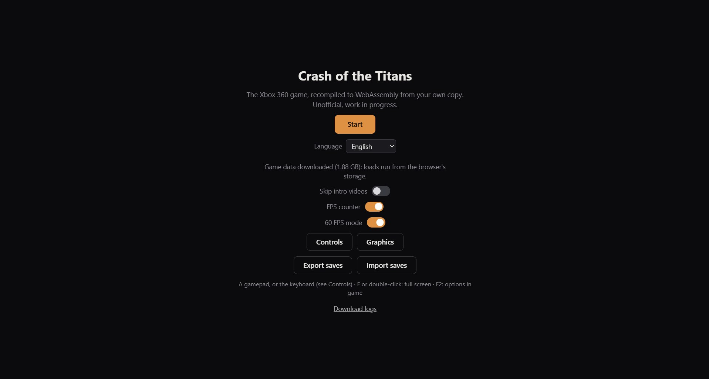
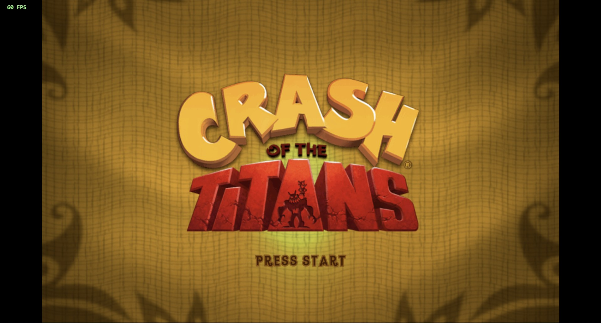
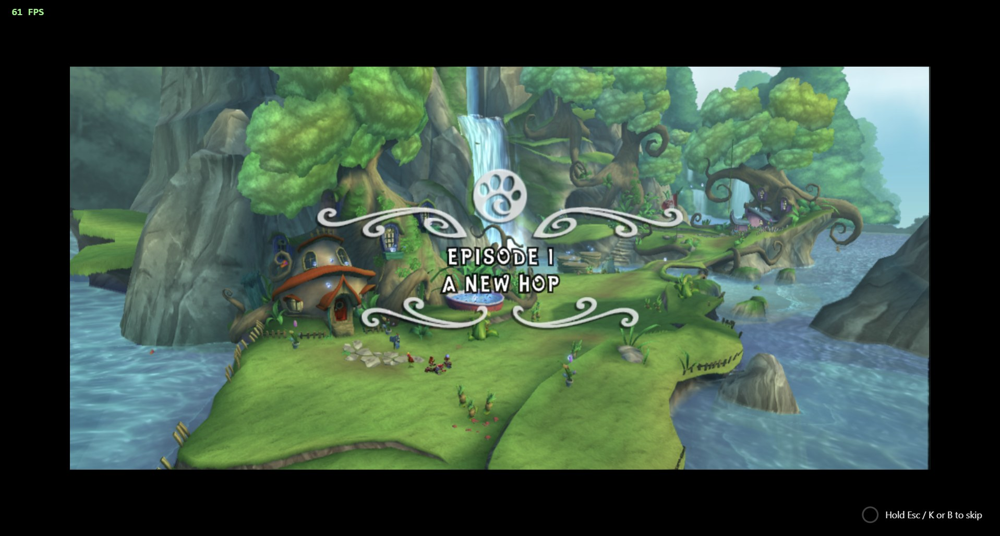
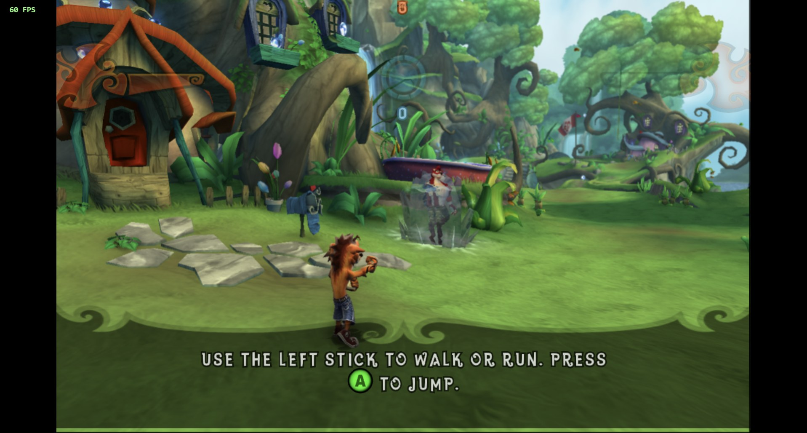

# Crash-OTT-web

Crash of the Titans (Xbox 360) in the browser, built from **your own copy** of the game.

> **Status: playable, work in progress.** The game boots, plays its videos, menus and story at its
> original 30 fps (or 60) in Chrome / Edge, with sound and controls. Some PC-only extras of crashott-pc are off, and
> a few rendering paths are still simplified: see [docs/ARCHITECTURE.md](docs/ARCHITECTURE.md).

This repository contains no game code and no game files (only the few screenshots below). You supply your own legally obtained
Xbox 360 disc image; a Docker build turns it into a browser module on your machine. What it produces is
derived from your game: keep it for yourself, never publish it (a private server of your own, behind a login, is
fine: [deploy/](deploy/README.md)).

It ports [crashott-pc](https://github.com/VitoMiguelF/crashott-pc) (a static recompilation of the
Xbox 360 game for PC, built with [XenonRecomp](https://github.com/hedge-dev/XenonRecomp)) to WebAssembly and
WebGPU.

## Screenshots

Taken in Chrome from the author's own copy, with the 60 FPS mode and the FPS counter on.

| | |
|---|---|
|  |  |
| The start page | The title screen |
|  |  |
| Episode 1's intro (hold to skip) | The first level |

## Requirements

- The Xbox 360 disc image of Crash of the Titans (the retail `default.xex`; the build checks its SHA-256).
- Docker, Python 3, git.
- To play: a Chromium-based browser with WebGPU.

## Build

```sh
git clone --recursive https://github.com/costa961/Crash-OTT-web
cd Crash-OTT-web

# 1. Your disc image -> game folder (default.xex, *.rcf, shaders/)
python tools/xiso.py extract "Crash of the Titans.iso" ../crashott-game --only "default.xex,*.rcf,shaders/*"

# 2. Build image (wasi-sdk, clang, SIMDe)
docker build -t crashott-build docker

# 3. default.xex -> C++ (out/recomp/generated/ppc, ~60 MB, 20144 functions)
docker run --rm -v "$PWD:/src" -v "$PWD/../crashott-game:/game:ro" -w /src crashott-build bash tools/recomp.sh

# 4. C++ -> wasm objects (out/web/obj)
docker run --rm -v "$PWD:/src" -w /src crashott-build bash tools/wasm_recomp.sh

# 5. Audio decoder (FFmpeg's WMA Pro, built from source; optional: without it the game is silent)
docker run --rm -v "$PWD:/src" -w /src crashott-build bash tools/ffmpeg_wasm.sh

# 5b. Runtime + link -> out/web/crashott.wasm
docker run --rm -v "$PWD:/src" -w /src crashott-build bash tools/wasm_runtime.sh

# Headless boot test under Node (no graphics yet)
docker run --rm -v "$PWD:/src" -v "$PWD/../crashott-game:/game:ro" -w /src crashott-build \
  node --experimental-wasm-exnref tools/run-node.mjs --game /game --timeout 60

# 6. The page
docker run --rm -v "$PWD:/src" -w /src/web crashott-build bash -c "npm install && node build.mjs"

# 7. Play: the local server, then http://localhost:8080 in Chrome or Edge (WebGPU)
docker run --rm -v "$PWD:/src" -v "$PWD/../crashott-game:/game:ro" -w /src -p 127.0.0.1:8080:8080 crashott-build \
  node tools/serve.mjs --game /game --host 0.0.0.0
```

## Playing

On the start page:
- **Language**: the six languages of the disc (the game's own voices and texts).
- **Download game data** (once, about 1.9 GB): the game files the game reads, into the browser's storage, for
  fast loads. Without it the game reads them from the local server.
- **Skip intro videos**: no logo videos, no legal-text wait, no title screen: straight to the main menu.
- **FPS counter**: on/off.
- **60 FPS mode**: 60 fps instead of the original 30 (crashott-pc's frame limit); needs a fast enough PC.
- **Controls**: the keyboard bindings, one key per pad input (click one, press the new key; Reset for the
  defaults below; Enter is always A too), and on the Gamepad tab which gamepad button is which pad input
  (click one, press the button).
- **Graphics**: a preset (Original, Low for integrated GPUs, Medium, High) or each option by hand: the internal resolution (720p, the original, up to 4K) and aspect ratio (the screen's, or
  16:9, 16:10, 21:9, 32:9, 4:3: wider shows more to the sides), the 60 FPS mode, anti-aliasing (off, FXAA, SMAA)
  and crashott-pc's motion blur, depth of field and shadow
  softness (0-200 %, 100 % = the game's own look); its lighting remaster: ambient occlusion (off, low, high),
  indirect light (GI) and its intensity, contact shadows, soft shadows (all off = the game's own look).
- **Export saves / Import saves**: your saves into a .zip file, and back (a backup, or to move them to
  another browser; importing replaces saves of the same name).
- **Download logs**: the log of the last session and of this one (to report a problem).

A browser that lacks something the game needs (WebGPU and an adapter for it, cross-origin isolation,
WebAssembly exception handling, the browser's file storage) is told so on the start page, and Start stays off.
Chrome and Edge are what the game is tested with. Firefox has WebGPU on Windows only (Firefox 141 and later)
and is untested there; Safari is untested.

In game: **F2** opens the Graphics options over the game (the game pauses; changes apply when you close
them, a new resolution included). **F** or a double-click toggles full screen (F11 works too); the picture is
drawn at the window's (or the screen's) own resolution. Switching to another tab or minimizing
the window pauses the game until you come back. **Hold B, Start or A** (keyboard: K, Esc, Space / Enter) for a
moment to skip a cutscene or an intro video: a prompt at the bottom right fills while you hold.

Controls: a gamepad (the browser's "standard" mapping, an Xbox layout), or the keyboard as pad 1 (defaults):

| Pad | Keyboard |
|---|---|
| Left stick | W A S D |
| D-pad | arrows |
| A | Space / Enter |
| B / X / Y | K / J / I |
| LB / RB | U / O |
| LT / RT | Q / E |
| Start / Back | Esc / Tab |
| Right stick | numpad 8 4 5 6 |

Saves stay in the browser (its storage for this site; Export saves for a copy); the first start copies the
saves an older build left on the local server (`out/userdata/content`).

## On a private server

[deploy/](deploy/README.md) runs the game on a server of your own (Docker, Caddy for HTTPS and a login), to play it
from anywhere. **Private servers only:** what the server holds comes from your copy of the game (your game files,
and the game module recompiled from it), so it stays behind the login, for you and at most a few people who own the
game, and its image never goes to a public registry. It is not a way to publish the game.

## Legal

The code in this repository is MIT-licensed ([LICENSE](LICENSE), [THIRD_PARTY_NOTICES.md](THIRD_PARTY_NOTICES.md)).
Crash of the Titans and its assets belong to their respective owners. This is an unofficial fan project, not
affiliated with or endorsed by them.
